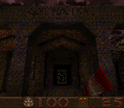
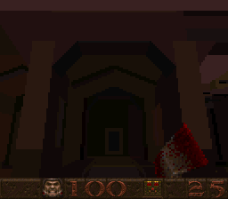
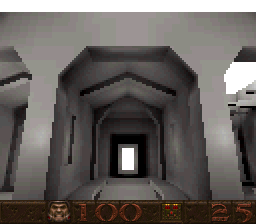
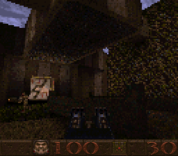
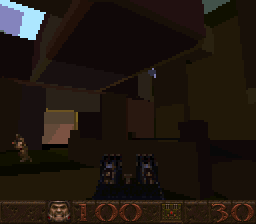
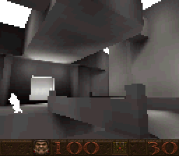
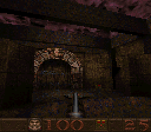
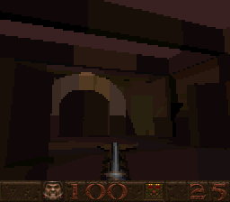
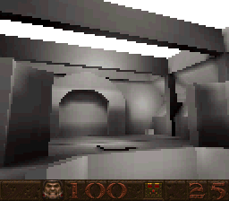

# SNES Quake

The final boss of Quake ports is here! It only took 30 years, a new version of
the FX chip, and the singularity to make it possible.

The port is still under heavy development, with plenty of room for
optimization. The five available levels are `start`, `e1m1`, `e1m2`, `e1m3`,
and `e1m4`. Proper gameplay is currently available only in `start` and `e1m1`.

The game uses FX3 and MSU-1 and runs in MesenCE. It should also work on
FXPak Pro / Mk. III hardware. If you can test it, I'd love to hear how it goes.

The goal is to port the entire game, starting with the demo.

[Play](#play) · [Videos](#videos) · [Screenshots](#screenshots) ·
[Controls](#controls) · [Tech](#tech) · [Build from source](#build-from-source) ·
[Release notes](docs/RELEASE_NOTES.md) · [Thanks](#thanks) · [License](#license) · [Support](#support)

## Videos

Both recordings show the game running with the emulator's **GSU clock at
300%**.

<table align="center">
<tr>
<th>E1M1 gameplay</th>
<th>Rendering features</th>
</tr>
<tr>
<td valign="top">

https://github.com/user-attachments/assets/c5edeb6a-4004-4309-8f2b-0628ab2a303d

</td>
<td valign="top">

https://github.com/user-attachments/assets/53c079bf-cf7e-455f-8a7f-9180c7246295

</td>
</tr>
<tr>
<td><a href="https://github.com/user-attachments/assets/c5edeb6a-4004-4309-8f2b-0628ab2a303d">snes_quake_e1m1.mp4</a> (4:42)</td>
<td><a href="https://github.com/user-attachments/assets/53c079bf-cf7e-455f-8a7f-9180c7246295">snes_quake_features.mp4</a> (0:53)</td>
</tr>
</table>

## Screenshots

| Textures + Lightmaps | Flat | Lightmaps |
| :---: | :---: | :---: |
|  |  |  |
|  |  |  |
|  |  |  |

## Play

1. [Build the ROM locally](#build-from-source).
2. Keep `snes_quake.sfc`, `snes_quake.msu`, and all numbered `snes_quake-*.pcm`
   audio tracks together in one directory.
3. Open `snes_quake.sfc` in [MesenCE](https://github.com/nesdev-org/MesenCE#development-builds)
   or an emulator with FX3 and MSU-1 support.

The cartridge boots into START. Choose a difficulty through the hub's
entrances, then use the Episode 1 portal to enter E1M1. This release includes
**E1M1 The Slipgate Complex**, **E1M2 Castle of the Damned**, **E1M3 The
Necropolis**, and **E1M4 The Grisly Grotto**. The other episode portals display
the shareware message.

## Controls

[](docs/media/controller-map.png)

In the menu, use **Up/Down** to select a setting and **Left/Right** to change its
value. Close the menu with **B** or **Start** to apply settings. Press **A** on
**Level** or **Restart** to load or restart a map. The selected **Skill** applies
when the map starts.

### SNES mouse in MesenCE

1. Open **Settings → Input**. Keep **Controller 1** as a SNES controller and
   set **Controller 2** to **SNES Mouse**.
2. Click the emulator picture to capture the mouse. Move the mouse to look,
   left-click to attack, or right-click to jump. Use the port 1 controls for
   movement and menu navigation.

## Tech

- **Super FX3 rendering.** The chip draws Quake's 3D levels with
  perspective-correct textures, baked lightmaps, moving doors, scrolling skies,
  and rippling liquids. Choose **Textures + Lightmaps**, **Flat**, or
  **Lightmaps Only**.
- **Display scale.** The **Scale** menu offers X2 (128×100) and X3 (85×67).
  The SNES enlarges the world for its 256×224 display and draws the HUD
  separately at full resolution.
- **QuakeC gameplay.** The SNES CPU runs supported routines from Quake's
  original bytecode for E1M1's monsters, pickups, and machinery while the FX3
  renders.
- **Animated sprites.** The build turns Quake's models into directional,
  animated sprites. The SNES draws the first-person weapon with hardware sprites.
- **MSU-1 streaming and audio.** The 4 MiB cartridge holds five map modules.
  MSU-1 loads code and E1M1 sprite data on demand and plays selected sounds
  in stereo alongside the SNES's own sound effects.
- **[Reference engine](src/reference_renderer/README.md).** An independent
  desktop C++ implementation models the port's gameplay and rendering. To check
  parity, replay the same input tape in the reference engine and the ROM in
  MesenCE. Compare gameplay state step by step and rendered frames pixel by pixel.

## Build from source


Use 64-bit Windows or Linux, Python 3.13, and Git. On Windows, install the
Visual Studio C++ workload and MSBuild. On Linux, install GNU make and a C
compiler. The first build fetches the pinned libSFX toolchain.

In the standalone source checkout, install the pinned Python dependencies and
run `python build.py`. The build extracts and verifies `PAK0.PAK` from the
included Quake 1.06 shareware ZIP. Extraction uses libarchive `bsdtar`
(`tar.exe` on Windows or the `libarchive-tools` package on Debian and Ubuntu).

```console
python -m pip install --require-hashes -r requirements.txt
python build.py
```

To use a matching original Quake shareware `PAK0.PAK` that you already have,
run `python build.py --pak /path/to/PAK0.PAK`. Use `--shareware /path/to/quake106.zip`
to select a different copy of the original ZIP.

The build writes the cartridge, MSU-1 files, and the build report to
`out/snes_quake/playable/`. The report `snes_quake-build.json` records
input provenance and the map, ROM, and sidecar identities.

## Source and game data

The source release includes the untouched Quake 1.06 shareware archive at
`third_party/quake106/quake106.zip`. The local build generates the ROM, MSU-1
sidecar, and PCM tracks.


## Thanks

- [id Software](https://www.idsoftware.com/) for creating Quake, its worlds,
  art and technology, and releasing the
  [Quake engine source](https://github.com/id-Software/Quake).
- [Limited Run Games](https://limitedrungames.com/) and Randy Linden for the
  [FX3 chip and its documentation](https://github.com/LimitedRunGames-Tech/snes-fx3).
- [David Lindecrantz (Optiroc)](https://github.com/Optiroc) for
  [libSFX](https://github.com/Optiroc/libSFX), the SNES development framework
  used by this project.
- [Mesen](https://www.mesen.ca/) creator Sour and the
  [Mesen Community Edition contributors](https://github.com/nesdev-org/MesenCE)
  for the emulator, debugger and Super FX support that make development and
  validation possible.

## License

Independently authored source code, tooling, and documentation use the
[MIT License](LICENSE). Quake assets, images, video, and third-party
dependencies retain their own terms. See the
[third-party notices](docs/THIRD_PARTY.md) for the scope and dependency details.
This is an unofficial Quake project.

## Support

SNES Quake is free and open source. Donations support its continued
development.

Feel free to open an issue with feature requests or suggestions.

Bitcoin (mainnet): [`bc1qza59dja7yjyqtd98y4qwthzpz904mrmrljwdua`](bitcoin:bc1qza59dja7yjyqtd98y4qwthzpz904mrmrljwdua)
