# SNES Quake 0.0.3

Explore Quake's **E1M3: The Necropolis** through a software renderer for
[Super FX 3](https://github.com/LimitedRunGames-Tech/snes-fx3). Replay the
shareware demo, explore with the fly camera, and switch between textures,
lightmaps, or both from the runtime menu.

This is a renderer demonstration, not a complete Quake game port.
[Build the ROM from source](docs/BUILDING.md) on Windows or Linux.

[Build](docs/BUILDING.md) · [Video](#video) ·
[Screenshots](#screenshots) · [Run](#run-the-rom) · [Controls](#controls) ·
[Limitations](#known-limitations) · [Thanks](#thanks) · [License](LICENSE)

## Video

### Realtime demo: X2

https://github.com/user-attachments/assets/a8d54d97-522d-41c7-b67d-ed66ce993661

### Realtime demo: X3 WARP

https://github.com/user-attachments/assets/16994b60-3501-4f63-b970-c977e66cbcd5

## Screenshots

Three views of E1M3: the hall, an interior encounter, and the ending area with
sky and fiends. Each row shows the same scene in three rendering modes.
Native Mesen captures show 128×112 rendering presented at 256×224.

| Textures + lightmaps | Textures only | Lightmaps only |
| :---: | :---: | :---: |
| 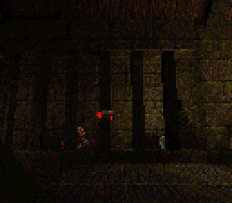 | 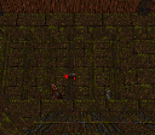 | 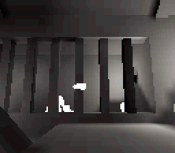 |
| **E1M3 hall: Textures + lightmaps** 15.0 s; source sample 450 at 30 Hz (zero-based) | **E1M3 hall: Textures only** 15.0 s; source sample 450 at 30 Hz (zero-based) | **E1M3 hall: Lightmaps only** 15.0 s; source sample 450 at 30 Hz (zero-based) |
| 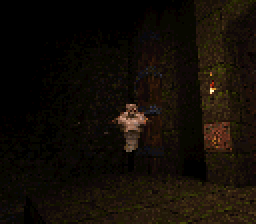 | 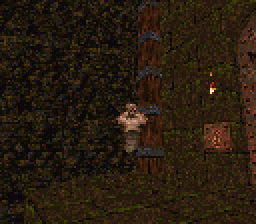 | 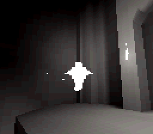 |
| **Textures + lightmaps** 60.4 s; source sample 1812 at 30 Hz (zero-based) | **Textures only** 60.4 s; source sample 1812 at 30 Hz (zero-based) | **Lightmaps only** 60.4 s; source sample 1812 at 30 Hz (zero-based) |
| 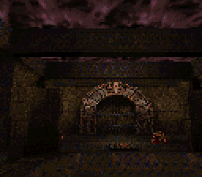 | 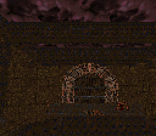 | 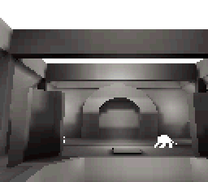 |
| **E1M3 ending with sky and fiends: Textures + lightmaps** fixed Fly camera | **E1M3 ending with sky and fiends: Textures only** fixed Fly camera | **E1M3 ending with sky and fiends: Lightmaps only** fixed Fly camera |

| Runtime menu |
| :---: |
| 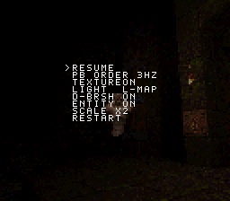 |
| **Runtime menu** 60.4 s; source sample 1812 at 30 Hz (zero-based) |

## Reference renderer

The desktop reference tool displays the source geometry and lighting, with
playback, rendering, sound and timeline controls. These captures show the same
hall and interior moments as the SNES gallery, with textures, lighting, moving
level objects, monsters and items enabled.

**C++ reference: E1M3 hall** — 15.0 s; source sample 450 at 30 Hz (zero-based); UI sample 451 (one-based)

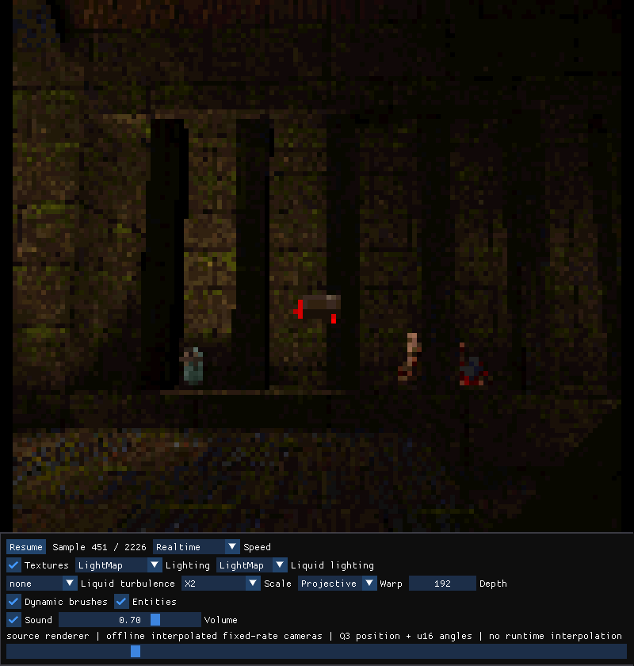

**C++ reference: E1M3 interior** — 60.4 s; source sample 1812 at 30 Hz (zero-based); UI sample 1813 (one-based)

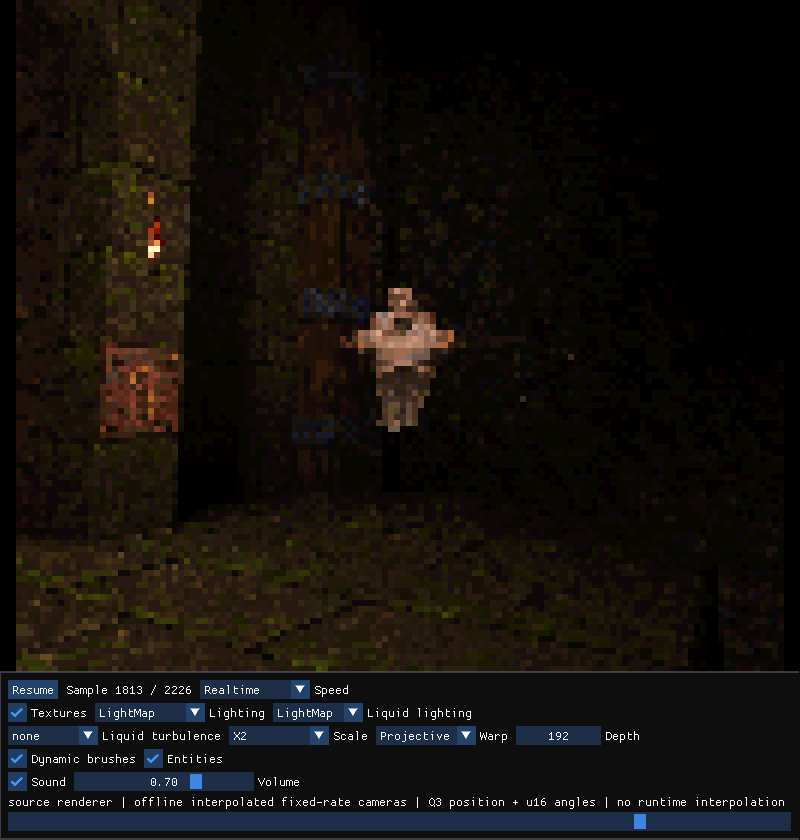

[Build and use the reference renderer](docs/REFERENCE_RENDERER.md).

The repository contains no extracted Quake game data, generated runtime assets
or prebuilt ROMs. The untouched shareware ZIP and the README screenshots are
retained; the build generates all runtime assets locally and records provenance.

## Current renderer

- Quake's original colors, textures and lighting
- Animated skies and liquids, plus moving doors, lifts and other level objects in demo and fly modes. Demo entity movement is interpolated at 30 Hz, with cuts and animation poses preserved
- Detailed monster and item images, rotating weapon pickups, and sprite effects
- During demo playback, monsters, pickups and sprite effects are hidden correctly behind walls and moving doors
- Native SNES sound synchronized with realtime demo playback
- Realtime demo playback, step-by-step playback for comparisons, and a fly camera for exploring the level
- A runtime menu for rendering, playback, level objects, monsters and items, colors, and sound
- X3 warp smooths camera movement between rendered frames using SNES Mode 7 and HDMA

## How X3 WARP works

**X3 WARP is frame reprojection using SNES Mode 7 and HDMA.** The Super FX
renders a scene at 85×74. While the next image is being rendered, the SNES
reuses the completed image and transforms it toward the current camera view.
Mode 7 maps its pixels onto the display; HDMA changes the Mode 7 transform and
scroll settings across horizontal bands during scanout, approximating camera
rotation and translation with a different transform in each band.

Reprojection updates at 30 Hz, while the NTSC display refreshes at about 60 Hz.
This smooths camera movement between fresh rendered images. It reshapes existing
pixels, so newly visible geometry, extra detail and entity animation still
require a new Super FX render. The approximation can stretch or distort pixels
where the scene's depth differs from the fitted warp model.

## Performance

**Default realtime demo playback: 2.832 fresh FPS.**
This counts newly rendered images with textures, lighting, moving level objects,
monsters, items and sound enabled. Playback stays on time by skipping scene
updates when rendering cannot keep up.
[Measurements and benchmark details](docs/PERFORMANCE.md).

## Run the ROM

[Build from source](docs/BUILDING.md) to produce `out/snes_quake/quake.sfc`.

On **Windows x64**, [download the tested MesenCE player](https://github.com/pisiiki/snes_quake/releases/download/v0.0.3/MesenCE-4b8a196e-Windows-x64-AOT.zip).
Extract the ZIP, run `Mesen.exe`, and open `quake.sfc`; no emulator build is needed.
This is the unchanged official upstream AOT build at
[`4b8a196e`](https://github.com/nesdev-org/MesenCE/commit/4b8a196e299b3de297b204fd1208d2981562c89b),
without this project's development instrumentation.

ZIP SHA-256: `6296e76cb086c54da97083f17adee2bb33a29695db4ee1135c8ea9c451c753b8`.
[Exact upstream source and license](https://github.com/pisiiki/snes_quake/releases/download/v0.0.3/MesenCE-4b8a196e-source.zip) ·
[Download provenance and qualification hashes](https://github.com/pisiiki/snes_quake/releases/download/v0.0.3/MesenCE-4b8a196e-PROVENANCE.json).

For Linux or macOS, see the upstream
[MesenCE development builds](https://github.com/nesdev-org/MesenCE#development-builds).

## Controls

| Input | Action |
| --- | --- |
| **Start** | Open the runtime menu; apply changes and close it. |
| **Up/Down** in the menu | Select a setting. |
| **Left/Right** or **A** in the menu | Change the selected setting. |
| **B** in the menu | Apply settings and close the menu. |
| **Select**, menu closed | Cycle the three rendering modes. |
| **D-pad**, `PLAYBACK FLY` | Look around. |
| **X/B**, fly mode | Move forward/back. |
| **Y/A**, fly mode | Strafe left/right. |
| **L/R**, fly mode | Previous/next monster viewpoint. |

### Mouse look and movement

1. In Mesen, open **Settings → Input**. Keep **Controller 1** as a SNES
   controller and set **Controller 2** to **SNES Mouse**.
2. Open the ROM's **Start** menu, select **PLAYBACK FLY**, then close the menu
   with **Start** or **B**.
3. Click inside the emulator picture to capture the mouse. Move the mouse to
   look around; the **left button moves forward** and the **right button moves
   backward**. Pause Mesen to release the mouse cursor.

For keyboard movement, map **W/S** to SNES **X/B** and **A/D** to SNES **Y/A**;
keep the arrow keys on the D-pad for menu navigation. Mesen's generic WASD
D-pad preset turns the camera instead of moving it. Mouse input controls the
fly camera while the ROM menu is closed; recorded demo playback uses its
authored camera. The mouse buttons move the camera rather than firing weapons.

## Known limitations

- This is a renderer demonstration, not a complete Quake game port.
- The included content path is the shareware demo1.dem on maps/e1m3.bsp; gameplay, AI, save games, networking, and the Quake console are not implemented.
- Rendering offers X2 (128x112) and X3 (85x74) indexed color at a 256x224 display. X3 warp smooths camera movement but does not increase completed-frame detail or animate entities between rendered frames. Detail and frame rate vary with scene complexity.
- Interactive fly mode is a development camera and does not provide Quake movement or collision semantics.

## Development

The project is developed with human direction and Codex-assisted programming.
An instrumented Mesen and the C++ reference renderer provide repeatable rendering
checks and performance measurements. See [release notes](docs/RELEASE_NOTES.md)
and [build instructions](docs/BUILDING.md).

## Thanks

- [id Software](https://www.idsoftware.com/) for creating Quake, its worlds,
  art and technology, and releasing the
  [Quake engine source](https://github.com/id-Software/Quake).
- [Limited Run Games](https://limitedrungames.com/) for the
  [FX3 chip and its documentation](https://github.com/LimitedRunGames-Tech/snes-fx3).
- [David Lindecrantz (Optiroc)](https://github.com/Optiroc) for
  [libSFX](https://github.com/Optiroc/libSFX), the SNES development framework
  used by this project.
- [Mesen](https://www.mesen.ca/) creator Sour and the
  [Mesen Community Edition contributors](https://github.com/nesdev-org/MesenCE)
  for the emulator, debugger and Super FX support that make development and
  validation possible.

## License

Original source code, tooling and documentation use the [MIT License](LICENSE).
Quake assets, images, video and third-party dependencies retain their own terms;
see [third-party notices](docs/THIRD_PARTY.md). This unofficial project is not
affiliated with or endorsed by id Software.

## Support

SNES Quake is free and open source. Donations support its continued
development.

Feel free to open an issue with feature requests or suggestions.

Bitcoin (mainnet): [`bc1qza59dja7yjyqtd98y4qwthzpz904mrmrljwdua`](bitcoin:bc1qza59dja7yjyqtd98y4qwthzpz904mrmrljwdua)
